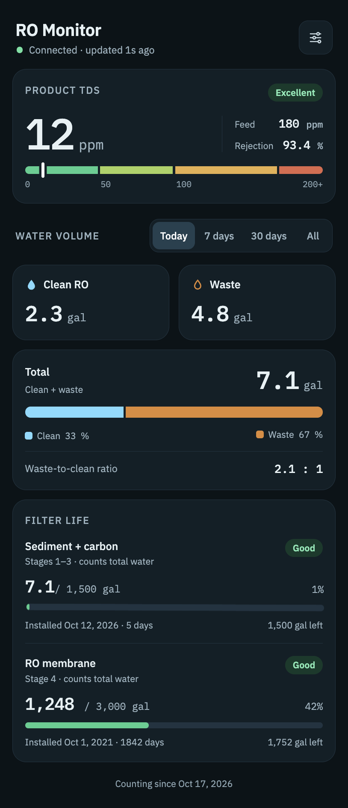

# RO System Monitor

Monitors a 4-stage under-sink reverse osmosis system with a Seeed XIAO ESP32-C3. It counts water in and out with two flow sensors (Today, 7 days, 30 days and all-time totals), reads product TDS, tracks filter life, and serves a mobile dashboard from flash at `ro-monitor.local`. Publishes to Home Assistant over MQTT discovery ([docs/home-assistant.md](docs/home-assistant.md)).



Status: Phase 4 (Home Assistant MQTT; firmware done, HA-side verification pending). UI dev without hardware: `python3 scripts/mock_server.py` (http://localhost:8080). See [docs/PLAN.md](docs/PLAN.md) for the roadmap.

## Wiring

| Part | Wire | XIAO ESP32-C3 |
|---|---|---|
| Flow sensor IN | red / black / yellow | 5 V / GND / GPIO2 (D0) |
| TDS module | VCC / GND / signal | 3V3 / GND / GPIO3 (D1) |
| Flow sensor OUT | red / black / yellow | 5 V / GND / GPIO4 (D2) |

The flow sensors may output 5 V pulses, which the ESP32-C3 cannot tolerate. Measure the signal wire first and add a divider if needed (see [docs/hardware.md](docs/hardware.md)).

## Build and flash

Requires [PlatformIO](https://platformio.org/).

```sh
cp include/secrets.example.h include/secrets.h   # then edit Wi-Fi / MQTT credentials
pio run                  # build
pio run -t upload        # flash firmware
pio run -t uploadfs      # upload web UI (build step gzips `ui/` into `data/`)
pio device monitor       # serial at 115200
pio test -e native       # host unit tests for the counter logic
```

### Wireless updates (OTA)

After the OTA firmware is on the board (first flash is over USB), update it over Wi-Fi. The upload password is `OTA_PASSWORD` from `include/secrets.h`. PlatformIO doesn't read that file, so export the same value in your shell, e.g. in `~/.zshrc`:

```sh
export OTA_PASSWORD='your-password'
pio run -e ota -t upload     # builds and uploads to ro-monitor.local
```

You can also upload a firmware or filesystem `.bin` from a browser at `http://ro-monitor.local/update` (user `admin`, same password).

The watchdog reboots the board if `loop()` hangs for 15 s. Long Wi-Fi outages restart the radio rather than the board.

Serial console commands (one per line): `s` status, `r`/`g` 1-gal calibration fill, `k in|out <pulses/gal>`, `t <ppm>` TDS calibration, `filter pre|mem <yyyy-mm-dd> [ratingGal]`, `used pre|mem <gal>` (overwrite used gallons), `reset` water counters, `inject <inGal> <outGal>` (test), `save`, `reboot`, `hang` (test the watchdog), `wipe yes`. See the header of `src/main.cpp`.

## Web UI and API

Open `http://ro-monitor.local` once the board is on Wi-Fi (or on the `RO-Monitor-Setup` fallback AP). The dashboard polls `GET /api/status` every 2 s. Other endpoints: `POST /api/settings` (filter install dates, ratings and optional `usedGal`), `POST /api/reset-counters`, and `GET/POST /api/calibration` (`kIn`, `kOut`, `kTds`, `waterTempC`; for curl, not in the UI). See [docs/PLAN.md](docs/PLAN.md) §5.

To work on the dashboard without hardware, run `python3 scripts/mock_server.py` and open http://localhost:8080.

## Layout

`src/` firmware · `include/` config and secrets · `ui/` dashboard source · `scripts/` UI build step and mock server · `test/` host unit tests · `web/` design mockup · `docs/` plan and hardware notes
